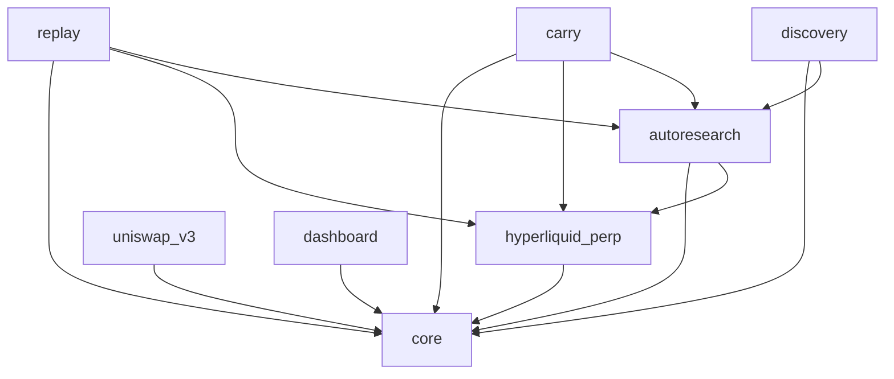

# contrib/

fork 自己寫的所有東西都在這裡。上游 `tradingagents/`（多 agent 分析與辯論）原樣保留；`contrib/` 把它接上真實市場、
加上研究迴圈、事後評估與監控。本檔回答三個問題：**每個套件做什麼、彼此怎麼連、整個系統怎麼循環**，最後附跨套件原則與閱讀入口。
細節（schema 版本、完整指令、參數、部署歷史）留在各套件自己的 README。

幾個下面會一直用到的詞：**引擎**＝真的送單的程序：`hyperliquid_perp`、`uniswap_v3`（`carry` 只協調，不是引擎）；
**線**＝一條交易線（`hyperliquid_perp`、`uniswap_v3`、`carry`），各自吐 `--json` 狀態；**RiskGate**＝perp 的確定性風控閘門；
**交接檔**＝一個套件寫、另一個套件讀的小 JSON 文件；**payload**＝perp 每個 cycle 餵給模型的 context 與格式區塊，存成檔，
replay 拿它把同一題重問別的模型（考古題）；**sidecar**＝寫在 payload 旁邊的附檔（`.handoff.json`＝perp 當天套用的交接檔紀錄，
另有 usage、reports）；**file-target run**＝目標不由 agents 產、而是讀交接檔的 perp run；
**DSL**＝autoresearch 的規則語法；**ledger／penalty／holdout**＝autoresearch 的實驗紀錄、多重比較門檻、最後才讀的保留窗口。

## 1. 導覽

| 套件 | 做什麼 | 主要輸入 → 輸出 | 文件 |
|---|---|---|---|
| [`hyperliquid_perp`](./hyperliquid_perp/README.md) | 永續合約的決策、風控與執行：agents 讀市場 context 輸出結構化目標，確定性的 RiskGate 與執行層把目標變成交易所動作 | 交易所市場資料、研究／護欄 JSON → `paper_trading.db`（唯一寫入者）、payload 與 sidecar、`status --json` | [docs/](./hyperliquid_perp/docs/README.md)、[RUNBOOK](./hyperliquid_perp/docs/RUNBOOK.md) |
| [`uniswap_v3`](./uniswap_v3/README.md) | 現貨策略與 swap 執行：策略只回答「目標比例」，同一個引擎換接線跑回測、paper、fork | 鏈上 bars、AI 判斷（`verdicts`，由 `verdict` 指令經 `agent/` 呼叫上游 `tradingagents/` 產生）、carry 交接檔（`targets`） → 自己的 sqlite、`status --json` | [RUNBOOK](./uniswap_v3/RUNBOOK.md) |
| [`autoresearch`](./autoresearch/README.md) | 假說搜尋：封閉 DSL 寫規則、確定性回測評估、ledger＋多重比較 penalty、holdout 鎖。promoted 規則產生 research signal；預先固定、不經 ledger 的護欄規則另外產生 guardrail signal | 交易所歷史 → `autoresearch.sqlite`（自己的）、research signal JSON、guardrail signal JSON | README 內 |
| [`replay`](./replay/README.md) | 事後評估：已記錄決策的成績單、同一題重問別的模型（考古題）、配對比較 | 讀 `paper_trading.db`＋payload＋`autoresearch.sqlite` → 報表、`replay.sqlite` | README 內 |
| [`carry`](./carry/README.md) | funding carry 的協調者：讀 funding 歷史、套一條規則、寫一份交接檔說兩條腿該持有什麼；`report` 唯讀對帳 | `autoresearch.sqlite`（`signal` 預設先經 autoresearch 的回補介面補 funding，`--no-fetch` 才純讀；可選讀兩腿 store 的 equity）→ 交接檔 JSON；`report` 唯讀兩顆交易帳本，`--json` | [RUNBOOK](./carry/RUNBOOK.md) |
| [`dashboard`](./dashboard/README.md) | 狀態匯出、告警、唯讀網頁 | 三條線的 `--json` CLI 輸出＋主機狀態 → status 目錄的 JSON、email、網頁 | README 內 |
| [`discovery`](./discovery/README.md) | 研究迴圈的 benchmark：造有標準答案的合成世界，用 autoresearch 自己的 port 與 `search()` 考它找不找得到埋的規律、會不會在雜訊裡硬掰。離線、不下單、不碰別的套件擁有的任何 store；**骨架（PR 1）已落地：manifest、最終判定、隔離棘輪；生成器與各臂在後續 PR** | 合成世界（自造）→ 每臂一顆自己的 `autoresearch.sqlite`、manifest／verdicts JSON | README 內 |
| [`core`](./core/) | 共用地板：instants、decimal context、digest、enum guard、atomic io。只依賴標準庫（有測試）、不含策略（慣例） | | |
| [`tests/`](./tests/) | 跨套件的架構限制：套件圖 `test_package_graph.py` | | |

## 2. 系統資料流

箭頭標的是交接方式：**JSON**＝交接檔；**CLI**＝子命令的 stdout；**SQLite**＝store，括號內是誰能寫。store 檔名依設定，圖裡是示意名。

```
 市場
   Hyperliquid 即時 ──► hyperliquid_perp
   Hyperliquid 歷史 ──► autoresearch
   鏈上 bars ────────► uniswap_v3

 研究
   autoresearch ──► autoresearch.sqlite（經它自己的寫入介面；carry signal 預設也經它回補 funding）
        │  JSON：research signal（進 prompt 的一段）
        │  JSON：guardrail signal（固定護欄規則最新一根的方向，進 RiskGate）
        ▼
 交易
   hyperliquid_perp ──► paper_trading.db（只有它寫）＋ payload ＋ sidecar（.handoff.json 等）
        ▲
        │  JSON：carry 交接檔（perp 腿＝file-target run）
   carry signal ◄── autoresearch.sqlite（讀；預設先經 autoresearch 回補 funding；可選讀兩腿 store 的 equity）
        │  JSON：同一份交接檔
        ▼
   uniswap_v3 `target` ──► uniswap.sqlite（只有它寫）
        現貨腿＝`external_weights` 策略，持有 `targets` 給的比例

 事後
   replay       ◄── 讀：paper_trading.db、autoresearch.sqlite、payload ──► 成績單、replay.sqlite
   carry report ◄── 讀：paper_trading.db、uniswap.sqlite、.handoff.json sidecar ──► 對帳報表（text／--json）

 監控
   dashboard export ◄── CLI：hyperliquid_perp status --json、uniswap_v3 status --json、carry report --json
                    ──► status 目錄 JSON（<line>.json、host.json、alerts.json）──► email 告警、唯讀網頁
```

`discovery` 不在圖裡：它只在離線的合成世界上跑 autoresearch 的搜尋，每臂一顆自己的 sqlite（經 autoresearch 的寫入介面回補），
不讀也不寫上面任何一個 store。

兩份進 perp 的 JSON（research signal、guardrail signal）都藏在 perp config 的開關後面，預設關。
「讀」交易帳本：carry 以 `mode=ro` 開檔；replay 走 perp 的 `Database(migrate=False)`，不 migrate、不寫，但不是唯讀開檔。
「讀」研究 store 則仍走 autoresearch 自己的 store 建構（會做 schema migrate），
所以研究 store 的規則是「只經 autoresearch 的寫入介面」，不是「只有 autoresearch 開它」。

引擎跟它的生產者（autoresearch、carry、replay）之間只靠這三種管道。**引擎套件整個都不 import 生產者**（`ALLOWED` 擋的是整個套件，
見 §3）；生產者可以 import 引擎的詞彙，因為它們在引擎程序外跑。
autoresearch 的訊號進 perp 只走 JSON、perp 不 import autoresearch，是 autoresearch 計畫 C1 階段（research signal 進 prompt）的拍板。

## 3. 套件依賴（Python import）

與上圖分開看：有資料往來不代表能 import。以 [`tests/test_package_graph.py`](./tests/test_package_graph.py) 的 `ALLOWED` 為準，
測試用 AST 掃描每個跨套件 import：多一條 `ALLOWED` 外的邊會紅，而借 perp 的套件碰到一個新的 perp 子套件也會紅
（`_PERP_REACH` 按完全相等比對），即使那條邊本來就允許。

`ALLOWED` 的每條邊（A → B＝A **可以** import B；這是上限，不是現況）：



上游 `tradingagents/` 不在 `ALLOWED` 的管理範圍：`hyperliquid_perp`、`autoresearch`、`replay` 的 src 會 import 它，`uniswap_v3` 只有 `agent/`（`verdict` 指令）那一支會。

- `core` 是地板：只依賴標準庫（`test_package_graph.py` 另外掃它），它不 import 任何人。`uniswap_v3` 今天實際**沒有** import `core`：它自己的 `tests/test_isolation.py` 擋掉所有 contrib import，`core` 也在內，`ALLOWED` 那條邊只是預留。
- `hyperliquid_perp` 與 `uniswap_v3` 彼此完全隔離；`dashboard` 只 import `core`，三條線都透過 CLI 讀。
- `autoresearch` 借 perp 的詞彙（regime、funding z-score、Candle）；`replay` 與 `carry` 同時借兩個鄰居（perp 與 autoresearch）；`discovery` 只借 `autoresearch`（port、`search()`、ledger 的閘門、評估器）與 `core`，它的 `tests/test_upstream.py` 連 tests 都擋住其他套件、`tradingagents` 與 venue SDK。有借鄰居的套件把借的東西（含 `core`）一律列在自己的 `upstream.py`，其他模組只從那裡 import；沒借鄰居的 perp 與 dashboard 直接 import `core`，沒有這層漏斗；`uniswap_v3` 連 `core` 都不 import（見上）。
- 邊是單向的：`ALLOWED` 本身有無環測試，`replay`／`carry`／`discovery` 各自的 `tests/test_upstream.py` 再守住「被借的套件不得 import 借它的套件」。

## 4. 主要 loop

**交易 loop**（`hyperliquid_perp`，每 4 小時一個 cycle）
市場資料 → context（含可選的 research 段）→ agents 輸出結構化目標 → RiskGate（含可選的 guardrail 方向）→ 執行（maker／paper 成交模擬）→ 帳本與 sidecar → 下一輪。
`uniswap_v3` 同型但更短：bars → 策略回答目標比例 → 偏離帶 → swap → store。

**研究 loop**（`autoresearch`）
歷史資料落地 → 模型（或人）提一條 DSL 規則 → parser 拒絕或接受 → 評估器在 train／validation 打分 → 失敗回饋進下一輪 prompt → …；
通過 penalty 門檻的規則才被 `promote`、才第一次讀 holdout；promoted 規則變成 research signal JSON 交給交易 loop。護欄規則不走這條：它是預先寫死、hash 釘住的 spec，`guardrail-signal` 只算它最新一根的方向並寫成交接文件。

**事後評估 loop**（`replay`）
已記錄的決策 → 成績單（方向勝率、研究訊號有沒有被跟隨）／考古題重放到別的模型 → 配對比較 → 人決定下一個實驗（換 prompt、換模型、翻開關）。

**carry loop**（`carry`＋兩條腿）
funding 歷史 → 一條規則（z-score 進出場）→ 日線邊界前寫交接檔 → perp 腿與現貨腿各自讀檔、各自閘門、各自執行 → `report` 唯讀對帳亮燈。

**監控**：`dashboard` 每兩分鐘跑三條線的 `--json` → 判斷告警規則 → 寫快照與歷史 → email 與網頁。

## 5. 跨套件的架構原則

1. **交易帳本的寫入權責唯一；研究 store 只經 autoresearch 的寫入介面。** `paper_trading.db` 只有 `hyperliquid_perp` 寫、uniswap 的 store 只有 `uniswap_v3` 寫，其他套件只讀不寫（開檔方式見 §2 末）。`autoresearch.sqlite` 的寫入介面在 `autoresearch`（`fetch`、`backfill_*`），`carry signal` 預設用它回補 funding，但不自己動 schema 或 ledger。`dashboard` 今天不開任何 store，只走三條線的 CLI；套件圖測試擋的是 import，不是開檔。
2. **下單與簽單只在兩個引擎裡。** `autoresearch`、`replay`、`carry`、`dashboard`、`discovery` 不簽任何交易、不送單（carry 決定兩腿該持有什麼、guardrail 進 RiskGate，但送單的永遠是引擎）。`autoresearch`、`replay`、`carry`、`discovery` 的 README 開頭都把「不下單／不是交易路徑」寫成 scope 判準，要放寬就是 scope creep；`dashboard` 只讀三條線的 `--json`。這條靠慣例，沒有測試擋住生產者去碰引擎的下單模組。
3. **交接文件的契約。** 引擎與生產者之間只走 JSON、CLI、SQLite 三種管道，方向規則見 §2 末與 §3。每份交接文件有自己的契約與版本欄位，目前有兩種做法：讀方宣告形狀、寫方 borrow 進來（`ResearchSignal` 住在 perp 的 schema，autoresearch 借它；只傳定性的帶，不傳研究 Sharpe 與策略門檻）；或兩邊各持一份版本常數、各自在自己的測試釘死同一個數字、沒有跨套件比對（carry 交接檔，因為讀方之一 `uniswap_v3` 不能 import 任何 contrib 套件）。`status --json`、`report --json` 各依自己的契約，裡面有數值。
4. **`core` 只放不含策略、只依賴標準庫的東西。** 「只依賴標準庫」有測試，多一個第三方套件就紅；「不含策略」是慣例。
5. **新增套件至少要改兩個檔案，有借才加。** 一定要：`tests/test_package_graph.py` 的 `ALLOWED` 加一列（少一列測試會點名）；本檔 §1 的表、§2 的圖、§3 的圖。有借鄰居再加自己的 `upstream.py`＋`tests/test_upstream.py` 列明借了誰；有借 perp 再改 `_PERP_REACH`。
6. **引擎套件整個不 import 生產者；生產者在引擎程序外，可以 import 引擎的詞彙。** 生產者（autoresearch 的兩個 signal 指令、`carry signal`、`replay`）有的排程、有的離線，都不在送單的程序裡，交接只走 §2 的三種管道。`replay` 會重用 perp 的 prompt 組裝程式碼來重建自己的模型輸入，但那是離線、不進線上交易員的 prompt 路徑，所以不違反這條。

## 6. 閱讀入口

| 我要… | 從這裡開始 |
|---|---|
| 跑 paper trading | [hyperliquid_perp RUNBOOK](./hyperliquid_perp/docs/RUNBOOK.md)、[uniswap_v3 RUNBOOK](./uniswap_v3/RUNBOOK.md)、[carry RUNBOOK](./carry/RUNBOOK.md) |
| 研究一條策略規則 | [autoresearch README](./autoresearch/README.md)：`vocab` → `fetch`（4h、1d、funding 三條序列）→ `experiment` → `evaluate`／`research` → `promote` → `signal` |
| 分析既有的 run | [replay README](./replay/README.md)：`score` 看成績單、`replay` 重問別的模型、`score --replay-db --variant [--against]` 逐題配對比較 |
| 看部署狀態與告警 | [dashboard README](./dashboard/README.md) |
| 加一個現貨策略 | [uniswap_v3 README「加一個策略」](./uniswap_v3/README.md#加一個策略) |
| 改套件之間的邊 | [tests/test_package_graph.py](./tests/test_package_graph.py) 的 `ALLOWED`、`_PERP_REACH` 與註解 |
| 考研究迴圈找不找得到埋的規律 | [discovery README](./discovery/README.md)：scope statement、manifest 格式、最終判定；生成器與各臂的指令隨後續 PR 補上 |
