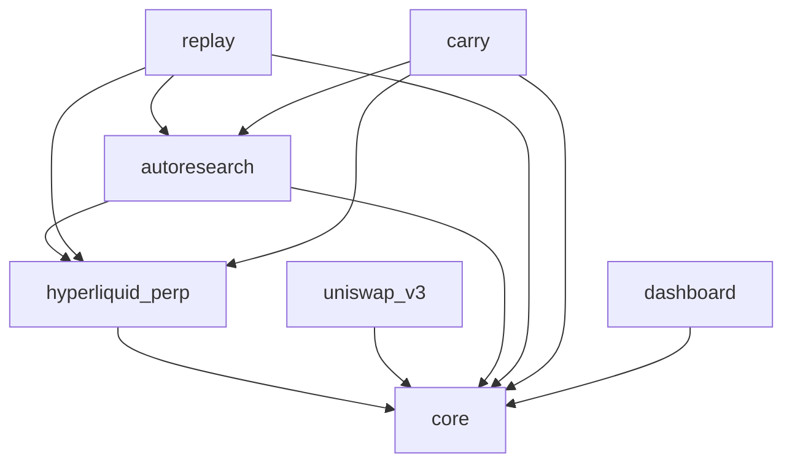

# contrib/

fork 自己寫的所有東西都在這裡。上游 `tradingagents/`（多 agent 分析與辯論）原樣保留；`contrib/` 把它接上真實市場、
加上研究迴圈、事後評估與監控。本檔只回答三個問題：**每個套件做什麼、彼此怎麼連、整個系統怎麼循環。**
細節（schema 版本、完整指令、參數、部署歷史）留在各套件自己的 README。

## 1. 導覽

| 套件 | 做什麼 | 主要輸入 → 輸出 | 文件 |
|---|---|---|---|
| [`hyperliquid_perp`](./hyperliquid_perp/README.md) | 永續合約的決策、風控與執行：agents 讀市場 context 輸出結構化目標，確定性的 RiskGate 與執行層把目標變成交易所動作 | 交易所市場資料、研究／護欄 JSON → `paper_trading.db`（唯一寫入者）、payload／handoff sidecar、`status --json` | [docs/](./hyperliquid_perp/docs/README.md)、[RUNBOOK](./hyperliquid_perp/docs/RUNBOOK.md) |
| [`uniswap_v3`](./uniswap_v3/README.md) | 現貨策略與 swap 執行：策略只回答「目標比例」，同一個引擎換接線跑回測、paper、fork | 鏈上 bars、AI 判斷（`verdicts`）、carry 交接檔（`targets`） → 自己的 sqlite、`status --json` | [RUNBOOK](./uniswap_v3/RUNBOOK.md) |
| [`autoresearch`](./autoresearch/README.md) | 假說搜尋：封閉 DSL 寫規則、確定性回測評估、ledger＋多重比較 penalty、holdout 鎖。promoted 規則產生 research signal；預先固定、不經 ledger 的護欄規則另外產生 guardrail signal | 交易所歷史 → `autoresearch.sqlite`（自己的）、research signal JSON、guardrail signal JSON | README 內 |
| [`replay`](./replay/README.md) | 事後評估：已記錄決策的成績單、同一題重問別的模型（考古題）、配對比較 | 唯讀 `paper_trading.db`＋payload＋`autoresearch.sqlite` → 報表、`replay.sqlite` | README 內 |
| [`carry`](./carry/README.md) | funding carry 的協調者：讀 funding 歷史、套一條規則、寫一份交接檔說兩條腿該持有什麼；`report` 唯讀對帳 | `autoresearch.sqlite`（`signal` 預設先經 autoresearch 的回補介面補 funding，`--no-fetch` 才純讀）→ 交接檔 JSON；`report` 唯讀兩顆交易帳本，`--json` | [RUNBOOK](./carry/RUNBOOK.md) |
| [`dashboard`](./dashboard/README.md) | 狀態匯出、告警、唯讀網頁 | 三條線的 `--json` CLI 輸出＋主機狀態 → status 目錄的 JSON、email、網頁 | README 內 |
| [`core`](./core/) | 不含策略、只依賴標準庫的共用地板：instants、decimal context、digest、enum guard、atomic io | | |
| [`tests/`](./tests/) | 跨套件的架構限制：套件圖 `test_package_graph.py` | | |

## 2. 系統資料流

箭頭標的是交接方式：**JSON 檔**＝一個套件寫、另一個讀的小文件；**CLI**＝子命令的 stdout；**SQLite**＝store，括號內是誰能寫。store 檔名依設定，圖裡是示意名。

```
 市場 ───────────────────────────────────────────────────────────────────────────────────────
   Hyperliquid 即時 ──► hyperliquid_perp          Hyperliquid 歷史 ──► autoresearch        鏈上 bars ──► uniswap_v3
                                                                                             │
 研究 ───────────────────────────────────────────────────────────────────────────────────────│───────────
   autoresearch ──► autoresearch.sqlite（經 autoresearch 的寫入介面；carry signal 預設也經它回補 funding）                                           │
        │  JSON：research signal（prompt 的一段，config 開關預設關）                           │
        │  JSON：guardrail signal（固定護欄規則的方向，給 RiskGate；config 開關預設關）                        │
        ▼                                                                                    │
 交易 ───────────────────────────────────────────────────────────────────────────────────────│───────────
   hyperliquid_perp ──► paper_trading.db（只有它寫）＋ payload sidecar ＋ .handoff.json sidecar│
        ▲                                                                                    ▼
        │  JSON：carry 交接檔 ◄── carry signal（讀 autoresearch.sqlite）──► JSON ──► uniswap_v3 `target` ──► uniswap.sqlite（只有它寫）
        │     （perp 腿是 file-target run）                                                      （現貨腿 external_weights 策略）
 事後 ───────────────────────────────────────────────────────────────────────────────────────────────────
   replay  ◄── SQLite 唯讀：paper_trading.db、autoresearch.sqlite；payload sidecar ──► 成績單、replay.sqlite
   carry report ◄── SQLite 唯讀：paper_trading.db、uniswap.sqlite；.handoff.json sidecar ──► 對帳報表（text／--json）
 監控 ───────────────────────────────────────────────────────────────────────────────────────────────────
   dashboard export ◄── CLI：hyperliquid_perp status --json、uniswap_v3 status --json、carry report --json
                    ──► status 目錄 JSON（<line>.json、host.json、alerts.json）──► email 告警、唯讀網頁
```

兩個交易帳本各有唯一寫入者，其他套件唯讀；研究 store 只經 autoresearch 的寫入介面。套件之間過資料只走 JSON 檔或 CLI 輸出，交易路徑上**不**跨套件 import
（autoresearch 的訊號進 perp 只走 JSON，是 C1 的拍板）。

## 3. 套件依賴（Python import）

與上圖分開看：有資料往來不代表能 import。以 [`tests/test_package_graph.py`](./tests/test_package_graph.py) 的 `ALLOWED` 為準，
測試用 AST 掃描每個跨套件 import，多一條邊就紅。

`ALLOWED` 的每條邊（A → B＝A 可以 import B）：



上游 `tradingagents/` 不在 `ALLOWED` 的管理範圍：`hyperliquid_perp`、`autoresearch`、`replay` 的 src 會 import 它，`uniswap_v3` 只有 `agent/`（`verdict` 指令）那一支會。

- `core` 是地板：只依賴標準庫，誰都能 import 它，它不 import 任何人。
- `hyperliquid_perp` 與 `uniswap_v3` 彼此完全隔離；`dashboard` 只 import `core`，三條線都透過 CLI 讀。
- `autoresearch` 借 perp 的詞彙（regime、funding z-score、Candle）；`replay` 與 `carry` 同時借兩個鄰居。借什麼一律列在各自的 `upstream.py`，其他模組只從那裡 import。
- 邊是單向的：被借的套件不得 import 借它的套件（`replay`／`carry` 各自的 `tests/test_upstream.py` 守著）。

## 4. 主要 loop

**交易 loop**（`hyperliquid_perp`，每 4 小時一個 cycle）
市場資料 → context（含可選的 research 段）→ agents 輸出結構化目標 → RiskGate（含可選的 guardrail 方向）→ 執行（maker／paper 成交模擬）→ 帳本與 sidecar → 下一輪。
`uniswap_v3` 同型但更短：bars → 策略回答目標比例 → 偏離帶 → swap → store。

**研究 loop**（`autoresearch`）
歷史資料落地 → 模型（或人）提一條 DSL 規則 → parser 拒絕或接受 → 評估器在 train／validation 打分 → 失敗回饋進下一輪 prompt → …；
通過 penalty 門檻的規則才被 `promote`、才第一次讀 holdout；promoted 規則變成 research signal JSON 交給交易 loop。護欄規則不走這條：它是預先寫死、hash 釘住的 spec，`guardrail-signal` 只算它每根的方向。

**事後評估 loop**（`replay`）
已記錄的決策 → 成績單（方向勝率、研究訊號有沒有被跟隨）／考古題重放到別的模型 → 配對比較 → 人決定下一個實驗（換 prompt、換模型、翻開關）。

**carry loop**（`carry`＋兩條腿）
funding 歷史 → 一條規則（z-score 進出場）→ 日線邊界前寫交接檔 → perp 腿與現貨腿各自讀檔、各自閘門、各自執行 → `report` 唯讀對帳亮燈。

**監控**：`dashboard` 每兩分鐘跑三條線的 `--json` → 判斷告警規則 → 寫快照與歷史 → email 與網頁。

## 5. 跨套件的架構原則

1. **交易帳本的寫入權責唯一；研究 store 只經 autoresearch 的寫入介面。** `paper_trading.db` 只有 `hyperliquid_perp` 寫、uniswap 的 store 只有 `uniswap_v3` 寫，其他套件開唯讀。`autoresearch.sqlite` 的寫入介面在 `autoresearch`（`fetch`、`backfill_*`），`carry signal` 預設用它回補 funding，但不自己動 schema 或 ledger。
2. **交易執行只在兩個引擎裡。** `autoresearch`、`replay`、`carry`、`dashboard` 不簽任何交易、不下單；它們的 README 第一句都是這個 scope 判準，要放寬就是 scope creep。
3. **跨套件交接走 JSON 檔或 CLI 輸出，不 import。** 每份文件有自己的契約與各自的版本欄位。研究訊號那一份（`ResearchSignal`）由讀方 perp 宣告形狀、寫方 autoresearch borrow 進來，而且只傳定性的帶（bias、confidence、drawdown），不傳研究 Sharpe 與策略門檻；carry 交接檔、`status --json`、`report --json` 各依自己的契約，裡面有數值。
4. **`core` 只放不含策略、只依賴標準庫的東西。** 套件圖測試另外掃 `core` 的 import，多一個第三方套件就紅。
5. **新增套件要同時改三處。** `tests/test_package_graph.py` 的 `ALLOWED` 加一列（少一列測試會點名）；套件自己的 `upstream.py`＋`tests/test_upstream.py` 列明借了誰；本檔 §1 的表與 §3 的圖。
6. **離線工具可以 import 鄰居，交易路徑不行。** `replay` 與 `carry` 不進入線上交易員的 prompt 建構路徑（replay 重建的是自己的模型輸入，離線），所以能 import；C1 的否決只針對交易路徑。

## 6. 閱讀入口

| 我要… | 從這裡開始 |
|---|---|
| 跑 paper trading | [hyperliquid_perp RUNBOOK](./hyperliquid_perp/docs/RUNBOOK.md)、[uniswap_v3 RUNBOOK](./uniswap_v3/RUNBOOK.md)、[carry RUNBOOK](./carry/RUNBOOK.md) |
| 研究一條策略規則 | [autoresearch README](./autoresearch/README.md)：`vocab` → `fetch` → `evaluate`／`research` → `promote` → `signal` |
| 分析既有的 run | [replay README](./replay/README.md)：`score` 看成績單、`replay` 重問別的模型、`score --replay-db --variant [--against]` 逐題配對比較 |
| 看部署狀態與告警 | [dashboard README](./dashboard/README.md) |
| 加一個現貨策略 | [uniswap_v3 README「加一個策略」](./uniswap_v3/README.md#加一個策略) |
| 改套件之間的邊 | [tests/test_package_graph.py](./tests/test_package_graph.py) 的 `ALLOWED` 與註解 |

**規劃中（尚未實作，不在上面的圖裡）**

- `discovery`：用有標準答案的合成世界評測 `autoresearch` 的研究能力（找不找得到埋的規律、會不會在雜訊裡硬掰）。只會 import `autoresearch` 與 `core`，不碰任何交易 store。落地後再納入 §1–§3。
